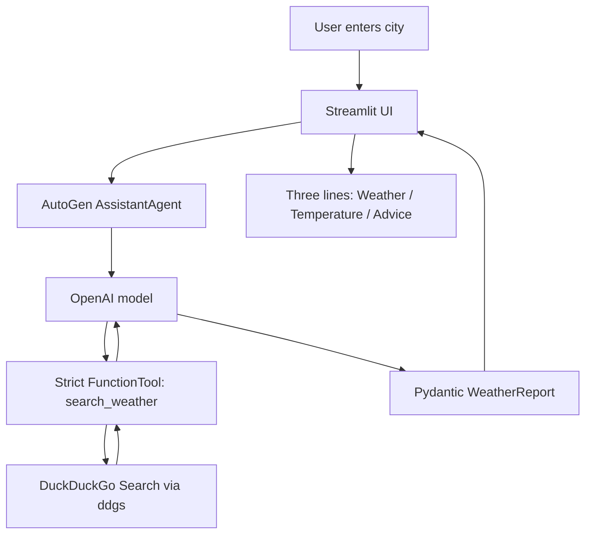

# 🌤️ Weather AI Agent — AutoGen + Streamlit

A Python weather-reporting AI agent built with **Microsoft AutoGen**, **OpenAI**, **DuckDuckGo Search (`ddgs`)**, and **Streamlit**. Enter a city, retrieve web search results, and display a concise report in three fields: **Weather**, **Temperature**, and **Advice**.

> **Note:** DDGS search does not require a search API key, but the OpenAI model does. Web search snippets may be stale or incomplete; this is a demonstration project, not an authoritative real-time weather service.

## Features

- Streamlit UI with a city input and **Get Weather Report** button
- AutoGen `AssistantAgent` to orchestrate the search and response
- `search_weather(city: str) -> str` with type hints and a descriptive docstring
- DuckDuckGo search via `ddgs`, without a search API key
- Strict AutoGen `FunctionTool` registration for structured-output compatibility
- `reflect_on_tool_use=True` to summarize tool results rather than display raw search snippets
- Pydantic `WeatherReport` with three fields, each displayed on a separate UI line
- API key loaded from `.env`, not hardcoded
- Asynchronous agent execution and model-client cleanup

## Architecture



## Project structure

```text
weather-ai-agent/
├── weather_news.py       # Streamlit UI, AutoGen agent and search tool
├── requirements.txt      # Python dependencies
├── .env                  # Local API key (never commit)
├── .gitignore            # Exclude secrets and caches
└── README.md
```

All application Python code is kept in **`weather_news.py`**.

## Prerequisites

- Python 3.10+ (a compatible Python version for your installed AutoGen packages)
- An OpenAI API key
- Internet access for OpenAI and DDGS search

## Installation

### 1. Create and activate a virtual environment

**Windows PowerShell:**

```powershell
py -m venv .venv
.\.venv\Scripts\Activate.ps1
```

**macOS / Linux:**

```bash
python3 -m venv .venv
source .venv/bin/activate
```

### 2. Install dependencies

Create `requirements.txt`:

```text
streamlit
autogen-agentchat
autogen-core
autogen-ext[openai]
ddgs
python-dotenv
pydantic
```

Then run:

```bash
python -m pip install -r requirements.txt
```

### 3. Configure environment variables

Create `.env` in the project root:

```dotenv
OPENAI_API_KEY=your_openai_api_key_here
OPENAI_MODEL=gpt-4o-mini
```

Add `.gitignore`:

```gitignore
.env
.venv/
__pycache__/
*.pyc
.streamlit/secrets.toml
```

**Security:** Never commit your API key or share `.env` publicly.

## Run the application

```bash
python -m streamlit run weather_news.py
```

Open **http://localhost:8501** if Streamlit does not open your browser automatically.

1. Enter a city (for example, `Chennai`).
2. Click **Get Weather Report**.
3. Wait while the agent searches and summarizes the results.
4. View the three weather fields.

## Example output

*Illustrative only — not a live forecast:*

```text
Weather: Chennai — cloudy conditions.
Temperature: 32°C; no rain reported in the search summary.
Advice: Stay hydrated and check local alerts.
```

The Streamlit UI displays each field separately. Structured output avoids depending on the model to insert exactly two newline characters.

## Implementation details

### 1. DDGS search tool

The application defines a typed function with a docstring:

```python
def search_weather(city: str) -> str:
    """Search the web for current weather, temperature, rain forecast, and advice for a city."""
    # Execute DDGS search and return source snippets.
```

The docstring/description explains the tool's purpose to the agent.

### 2. Strict function tool

When using Pydantic structured output, register the search function as a strict AutoGen tool:

```python
from autogen_core.tools import FunctionTool

weather_tool = FunctionTool(
    func=search_weather,
    description="Search weather conditions, temperature and rain forecast for a city.",
    strict=True,
)
```

Then pass `tools=[weather_tool]` to the agent, rather than passing the plain Python function.

### 3. AutoGen agent

The agent uses these important settings:

```python
agent = AssistantAgent(
    name="weather_reporter",
    model_client=model_client,
    tools=[weather_tool],
    reflect_on_tool_use=True,
    output_content_type=WeatherReport,
    max_tool_iterations=2,
    system_message="Use the weather search tool and return three concise weather fields.",
)
```

- `tools`: exposes DDGS search to the agent.
- `reflect_on_tool_use=True`: asks the model to formulate the final response after receiving tool results.
- `output_content_type=WeatherReport`: requests validated structured output.
- `max_tool_iterations=2`: limits tool-use iterations; it does **not** guarantee a single model call.

### 4. Three-field structured output

```python
from pydantic import BaseModel

class WeatherReport(BaseModel):
    weather: str
    temperature: str
    advice: str
```

Render the fields individually in Streamlit to reliably show **three display rows**. The values still depend on the accuracy of the search results and model interpretation.

### 5. Asynchronous execution and cleanup

Streamlit invokes the async agent with `asyncio.run(...)`. The model client is closed in a `finally` block:

```python
try:
    result = await agent.run(task=f"Report current weather for {city}.")
finally:
    await model_client.close()
```

This releases client resources even if a request fails.

## Troubleshooting

| Problem | Likely cause | Fix |
|---|---|---|
| `search_weather is not strict` | Plain function tool used with strict structured output | Wrap with `FunctionTool(..., strict=True)` |
| `ModuleNotFoundError: autogen_agentchat` | Missing or incorrect AutoGen package | Run `python -m pip install -U autogen-agentchat autogen-core 'autogen-ext[openai]'` (quote syntax may vary by shell) |
| `ModuleNotFoundError: streamlit` | Streamlit not installed in the active Python environment | Run `python -m pip install streamlit` |
| Missing `OPENAI_API_KEY` | `.env` missing or not loaded | Create `.env` in the project root and restart the app |
| Output appears as one paragraph | Free-form LLM response used | Use Pydantic structured output and render the three fields separately |
| DDGS returns no results | Search service rate limiting or connectivity issue | Retry later, verify connectivity, and avoid repeated searches |
| Streamlit screen is blank | Unhandled exception or environment mismatch | Check terminal traceback and confirm the active virtual environment |

## Limitations and next steps

- DDGS is a general web search tool, not a dedicated meteorological API. Search snippets may be outdated or contradictory.
- An LLM can still misinterpret search results; do not treat the report as a safety-critical forecast.
- Strict tools and Pydantic validate schema shape, not factual accuracy.
- Future improvements could add a weather API, source timestamps, caching, forecast icons, weather alerts, or a search-result inspection panel.

## Technology stack

| Layer | Technology |
|---|---|
| Frontend | Streamlit |
| Agent orchestration | Microsoft AutoGen AgentChat |
| Language model | OpenAI (`gpt-4o-mini` by default) |
| Search | DuckDuckGo via `ddgs` |
| Tool interface | AutoGen `FunctionTool` with `strict=True` |
| Output validation | Pydantic |
| Configuration | `python-dotenv` |

## License

Add a license appropriate for your repository before public distribution.
